# Brightside · Patient Appointment & No-Show Reduction System

A patient booking webapp with Gmail confirmations and reminders, a waitlist that re-fills cancelled slots, and a Google Sheet the front desk works from. Patients book, confirm and cancel themselves; staff only record whether they turned up. An hourly sync feeds a Metabase dashboard that shows where no-shows happen and whether the fixes worked.

**Stack:** Python · Flask · Google Sheets API · Google Apps Script · Gmail SMTP · SQLite · SQL · Metabase

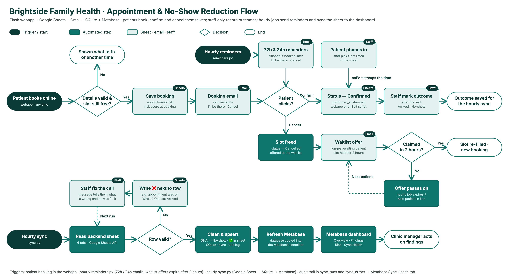

## The problem

Brightside Family Health is a fictional three-clinic practice (Northgate, Riverside, Eastview) with nine providers. Bookings were taken by phone and about **1 in 5 patients didn't turn up**, which cost about $51k a month in empty slots. Reminders were ad hoc phone calls, nobody knew who was likely to miss, and when someone did cancel, the slot usually stayed empty.

## How it works, day to day

### 1. The patient books online

The patient picks what they need, a clinic and a time, then enters their name, email and mobile. The page only offers times that are still free, and refuses a slot someone else took a second earlier.

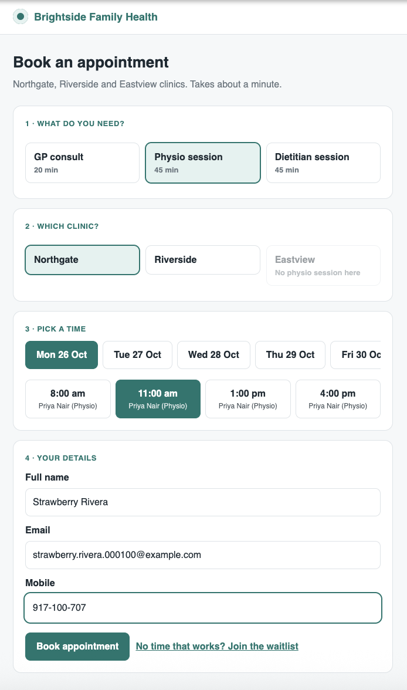

Each booking gets a **no-show risk score** with reasons staff can read: past no-shows, new patient, booked more than two weeks ahead, before 9am, Monday ([`app/risk.py`](app/risk.py)).

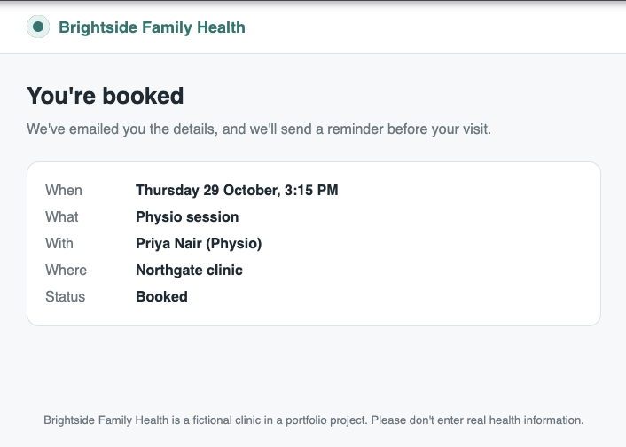

### 2. It's recorded in the Google Sheet

The front desk works from one Google Sheet. Every booking from the webapp lands in the **appointments** tab within a second, with its status, risk score and a `sync_status` column the system writes back. Staff edit only the **status** column, from a dropdown (Booked / Confirmed / Arrived / No-show / Cancelled). Every other column shows a warning if someone tries to edit it ([`app/sheets.py`](app/sheets.py)).

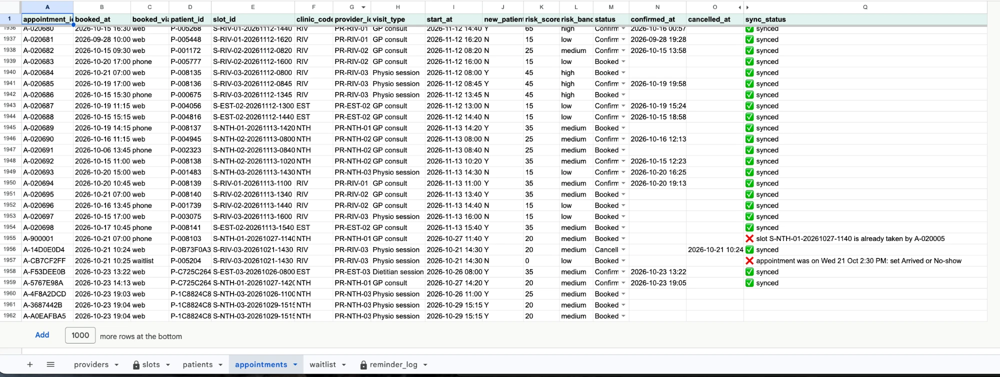

The other tabs hold the schedule (`providers`, `slots`), `patients`, the `waitlist`, and a `reminder_log` of every email sent. Whether a slot is free is worked out from the appointments themselves, so a slot can never be both free and booked.

### 3. Emails confirm and remind

| Email | Sent | Buttons |
|---|---|---|
| Booking confirmation | The moment they book | **I'll be there** · **Cancel** |
| 3-day reminder | 72 hours before | **I'll be there** · **Cancel** (only Cancel once confirmed) |
| 1-day reminder | 24 hours before | Same |
| Waitlist offer | When a slot they're waiting for opens up | **Book this time** |

Reminders come from an hourly job ([`app/reminders.py`](app/reminders.py)). Each one is logged and never sent twice, and a reminder whose time had already passed when the patient booked is skipped. Someone booking this morning for this afternoon gets one email, not three. Emails go out through Gmail ([`app/mailer.py`](app/mailer.py)).

| Booking confirmation | 3-day reminder | 1-day reminder |
|---|---|---|
| 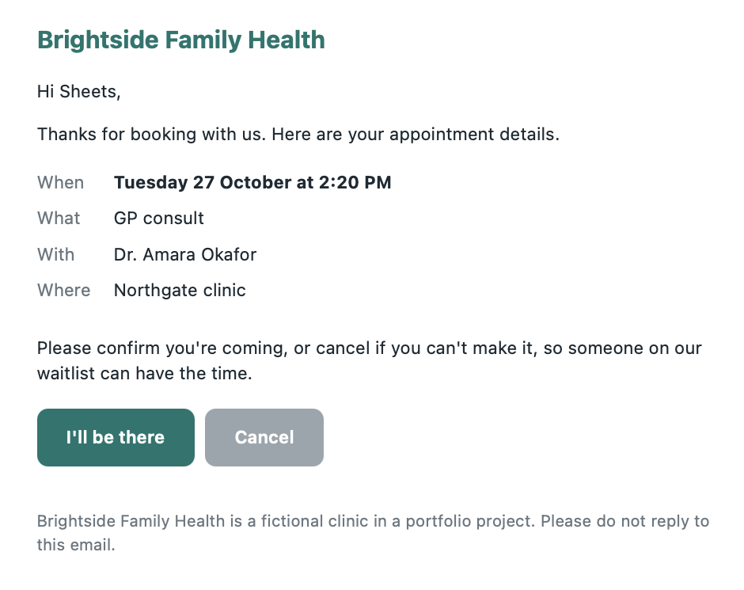 | 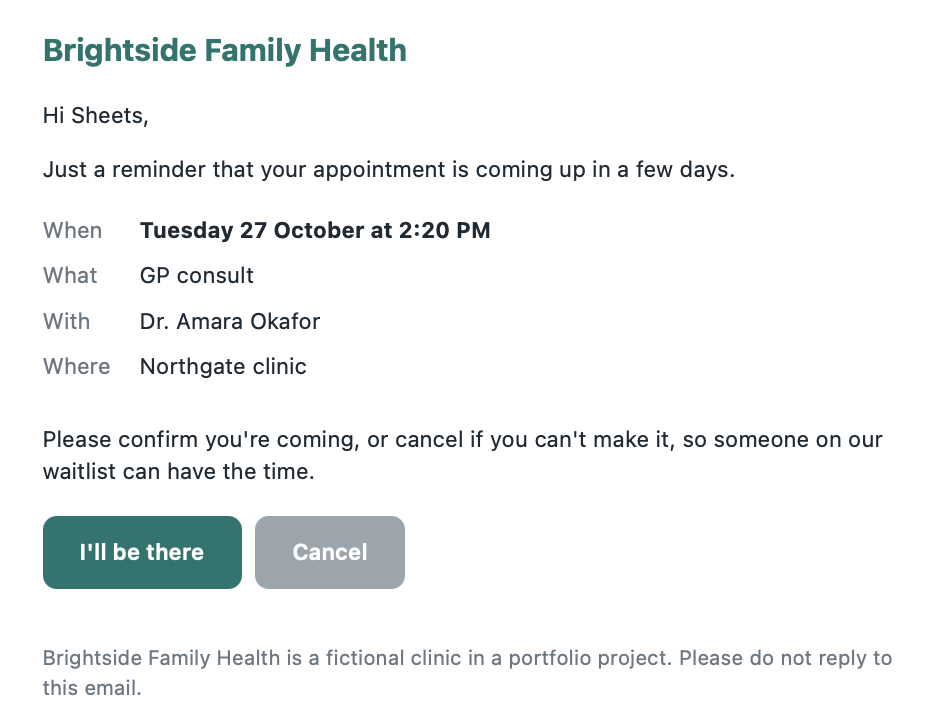 | 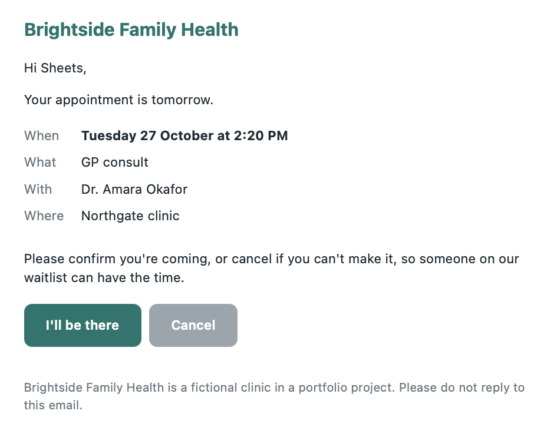 |

### 4. The patient confirms or cancels

**I'll be there** opens a page with one button. Pressing it sets the status to **Confirmed** in the sheet and records `confirmed_at`. The links open a page instead of acting straight away, because email security scanners open links in advance and would otherwise confirm or cancel bookings by themselves.

| From the email | After pressing the button |
|---|---|
| 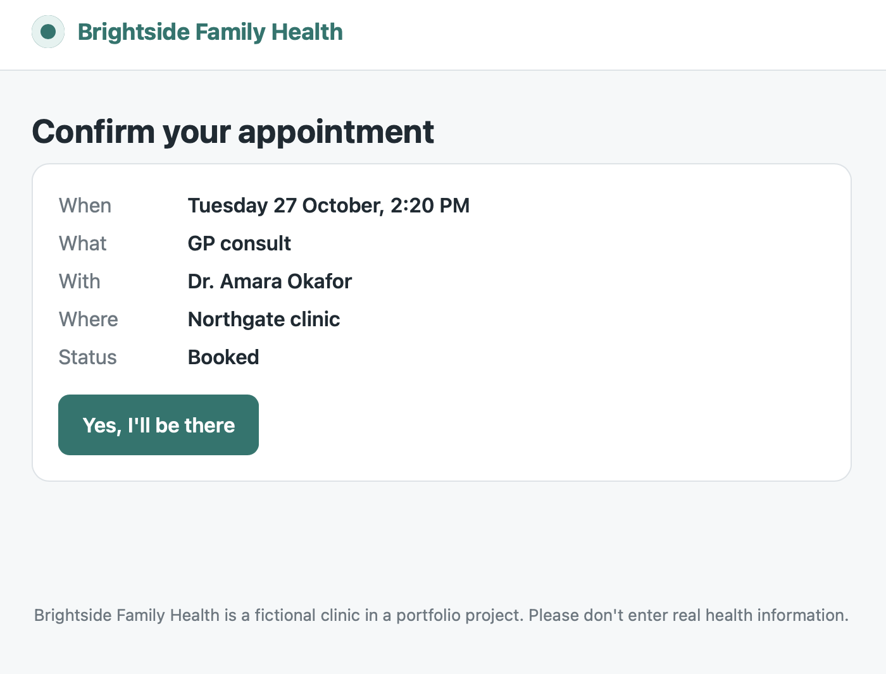 | 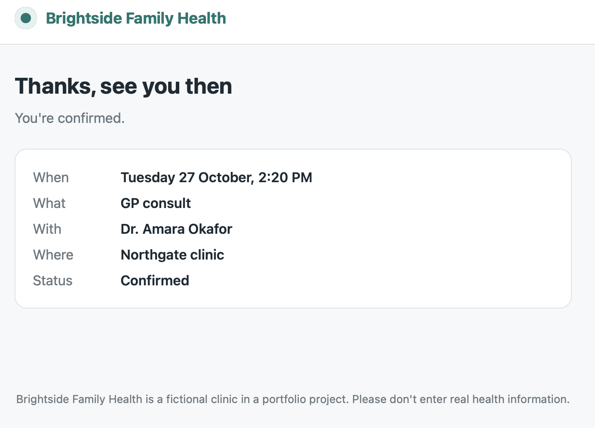 |

**Cancel** frees the slot and immediately emails the patient who has waited longest for that visit type at that clinic. The slot is held for them for 2 hours, then passed to the next person ([`app/waitlist.py`](app/waitlist.py)).

| Waitlist offer email | After pressing "Book this time" |
|---|---|
| 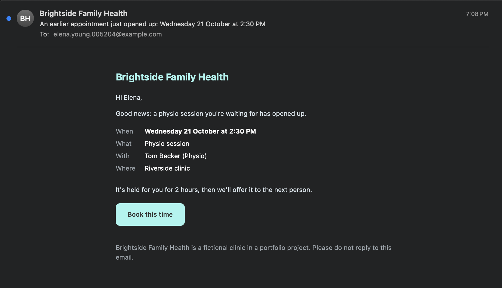 | 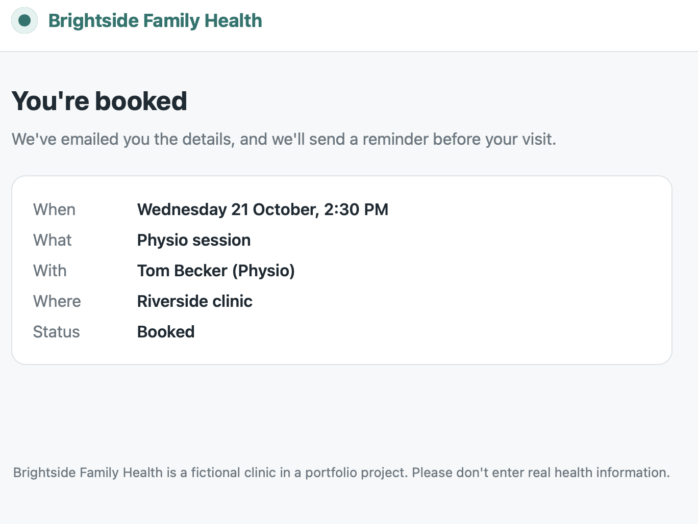 |

**If the patient phones instead,** staff pick **Confirmed** in the sheet, and a small Apps Script ([`apps_script/onEdit.gs`](apps_script/onEdit.gs)) stamps `confirmed_at` at that moment. Phone confirmations then count the same as email ones on the dashboard.

Staff pick **Confirmed** on the row:

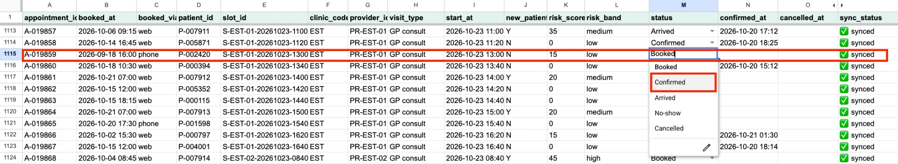

The script fills in `confirmed_at` straight away:

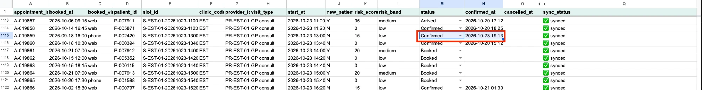

### 5. Staff mark who arrived

After each visit, staff set the status to **Arrived** or **No-show** from the dropdown. That's the only routine task the system leaves to people.

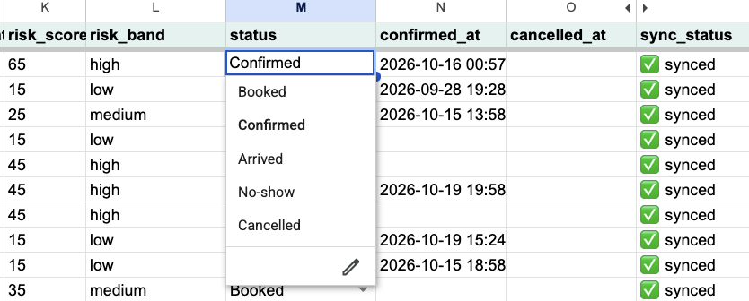

### 6. The hourly sync checks the sheet

Every hour, [`app/sync.py`](app/sync.py) reads the sheet, cleans what it can, rejects what it can't, and writes the result next to each row, so staff can see exactly what to fix ([`app/validate.py`](app/validate.py)):

| Staff typed | Sync does | Written to `sync_status` |
|---|---|---|
| `DNA`, `no show`, `noshow` | Maps it | ✅ synced · fixed: status 'DNA' → No-show |
| `seen`, `Attended` | Maps it | ✅ synced · fixed: status 'seen' → Arrived |
| `cxl` | Maps it | ✅ synced · fixed: status 'cxl' → Cancelled |
| `(212) 555-0157` | Reformats it | ✅ synced · fixed: phone '(212) 555-0157' → 212-555-0157 |
| Still `Booked` a day after the visit | Flags it | ❌ appointment was on Wed 14 Oct 11:00 AM: set Arrived or No-show |
| `Arrived` on next week's appointment | Rejects it | ❌ marked Arrived but the appointment isn't until Mon 26 Oct 8:00 AM |
| `Left early` | Rejects it | ❌ status 'Left early' isn't one of: Booked, Confirmed, Arrived, No-show, Cancelled |
| `PR-RIV-1` | Rejects it | ❌ unknown provider_id 'PR-RIV-1' (did you mean PR-RIV-01?) |
| A phone booking typed onto a taken slot | Rejects the later one | ❌ slot S-NTH-01-20261027-1140 is already taken by A-020005 |

Typos cleaned up, with a note saying what was changed:

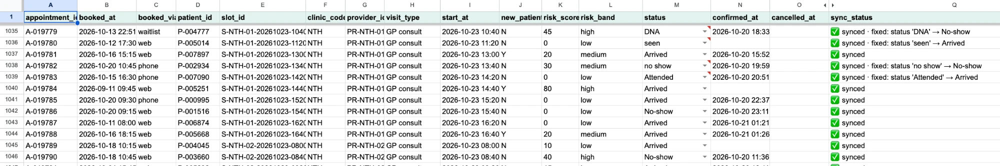

Rows it can't fix, with what to do:

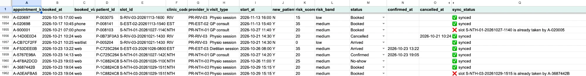

When staff correct a row, the next run loads it and clears the error. Clean rows go into the analytics database, and Metabase is refreshed.

### Running every hour

The reminder job and the sync run together every hour ([`scripts/run_every_hour.sh`](scripts/run_every_hour.sh)), reminders first so their email log syncs too. On a server it's one cron line per job ([`scripts/hourly_sync.sh`](scripts/hourly_sync.sh)).

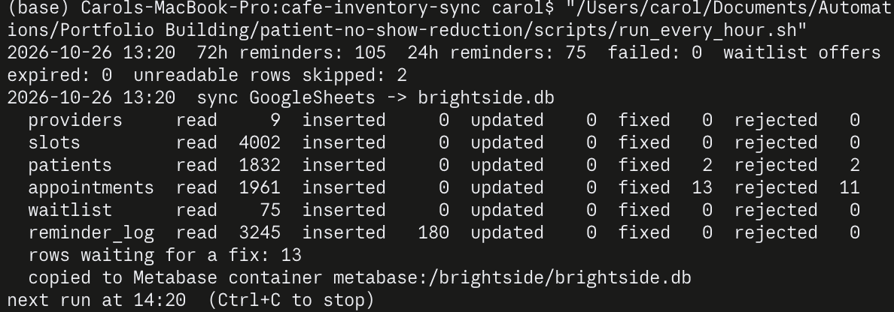

- **Safe to re-run:** every write is an upsert on the row's ID, and reminders check the log before sending. Running either job twice changes nothing.
- **One bad cell never stops the rest:** the reminder job skips rows it can't read, and a tab that fails to sync is logged while the other tabs carry on.
- **Audited:** every sync run is logged (`sync_runs`), and every problem row with its sheet row number, original values and when it was fixed (`sync_errors`).

## The dashboard

Metabase, with a Clinic filter across four tabs. The SQL for every card is in [`dashboard/`](dashboard/), and the views it reads are in [`sql/views.sql`](sql/views.sql).

**Overview:** no-show rate and revenue lost (last 30 days), share of cancelled slots re-filled, high-risk patients who haven't confirmed yet this week, and the weekly no-show trend.

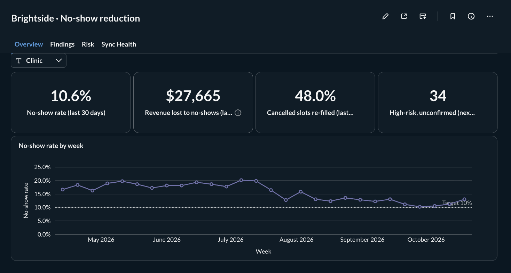

### Findings

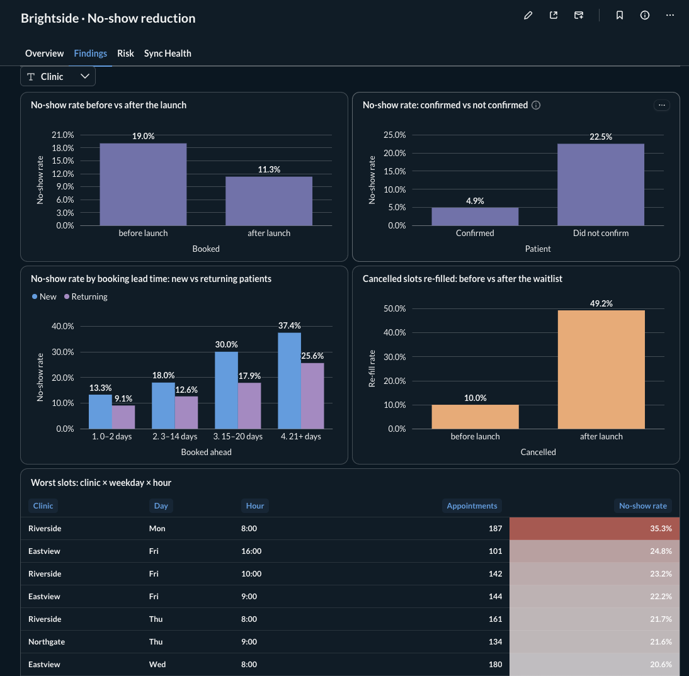

| Finding | Evidence | SQL |
|---|---|---|
| Email confirmations and reminders cut no-shows by 40% | 19.0% before the 20 Jul launch → 11.3% after. Cancellations rose from 7.9% to 10.2%, which is the point: a cancelled slot can be re-filled | [01](dashboard/findings/01-no-show-rate-before-vs-after-launch.sql) |
| Riverside's Monday 8am hour is the worst in the network | 35% no-show, against 15.6% overall. Candidate for moving those slots later in the day | [02](dashboard/findings/02-worst-slots-by-clinic-weekday-hour.sql) |
| New patients booking 3+ weeks out rarely turn up | 37% no-show, against 9% for returning patients booking within 2 days | [03](dashboard/findings/03-no-show-rate-by-lead-time-new-vs-returning.sql) |
| One click on "I'll be there" is the strongest signal | 4.9% no-show for patients who confirmed, 22.5% for those who didn't | [04](dashboard/findings/04-no-show-rate-confirmed-vs-not.sql) |
| The waitlist re-fills half of all cancellations | 10% of cancelled slots re-filled by chance before, 49% after (about $44k recovered) | [05](dashboard/findings/05-cancelled-slots-refilled-before-vs-after.sql) |

**Risk:** actual no-show rate by risk band (low 11.7%, medium 17.0%, high 27.3%), which checks the booking-time score means something.

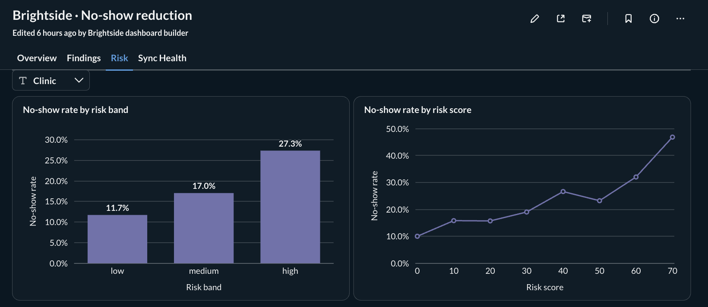

**Sync Health:** last sync, rows waiting for a fix, failed runs, rejected rows by error type, the rows to fix, and patient emails sent per day.

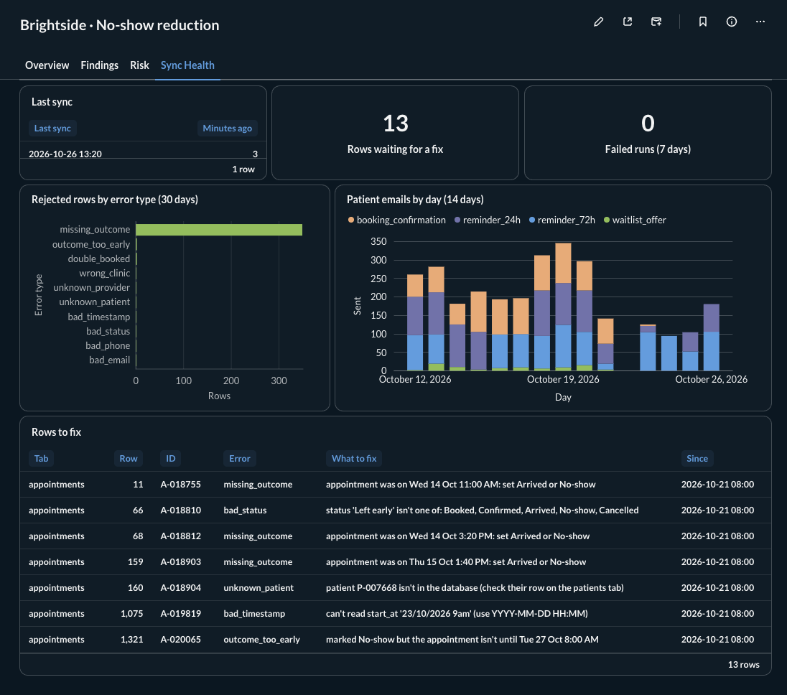

## Running it

You'll need a Google Sheet shared (Editor) with a Google Cloud service account that has the Sheets API enabled, and a Gmail [app password](https://myaccount.google.com/apppasswords) for sending. Settings are listed in [`.env.example`](.env.example).

```bash
python3 -m venv .venv && .venv/bin/pip install -r requirements.txt
cp .env.example .env                       # sheet, Gmail and database settings
.venv/bin/python app/webapp.py             # booking site on http://localhost:5050
scripts/run_every_hour.sh                  # reminders + sync, now and every hour
.venv/bin/python -m unittest discover tests
```

To stamp phone confirmations, paste [`apps_script/onEdit.gs`](apps_script/onEdit.gs) into the sheet (Extensions → Apps Script) and save. It's a simple trigger, so there's no authorisation step.

## About the data

Brightside is fictional, and so is every patient: made-up names, `@example.com` emails and 555-01xx phone numbers. **No real patient or health data is used anywhere.** Six months of appointment history were simulated so the dashboard has something to find. The data generator and database setup aren't part of this repository.

**Known limitations:** the risk weights are hand-set rules checked against outcomes, not a fitted model. Bookings are checked and saved one at a time inside the webapp, which is enough for a single webapp process. Running several would need a shared lock, since Google Sheets has no transactions; if two bookings ever did land on one slot, the sync flags the later one as `double_booked`.

## Repository

```
app/webapp.py          booking site: book, confirm, cancel, join the waitlist, claim an offer
app/booking.py         slot availability, patient lookup, booking rules
app/risk.py            no-show risk score
app/waitlist.py        waitlist offers, claims and expiry
app/reminders.py       hourly job: 72h / 24h reminder emails, waitlist offer expiry
app/mailer.py          email templates, sent through Gmail
app/sheets.py          the Google Sheet backend (and a local CSV stand-in for tests)
app/sync.py            hourly sync: sheet -> analytics database, status written back to the sheet
app/validate.py        cleaning and validation rules
app/config.py          clinics, visit types, sheet tabs, settings (read from .env)
app/templates/         the webapp's pages
apps_script/onEdit.gs  stamps confirmed_at when staff confirm an appointment in the sheet
scripts/               hourly jobs: a terminal loop and a cron wrapper
dashboard/             the SQL behind every Metabase card, one file per card
sql/views.sql          analytics views the dashboard is built on
tests/                 booking, cancel and waitlist, reminders, validation rules, risk score
screenshots/           webapp, emails, sheet, terminal, dashboard
flowchart.png          end-to-end flow
```
